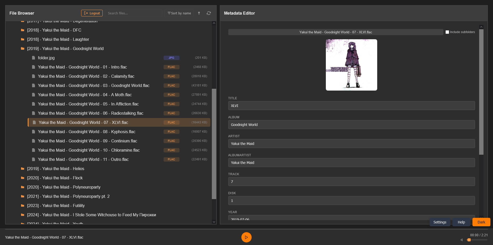
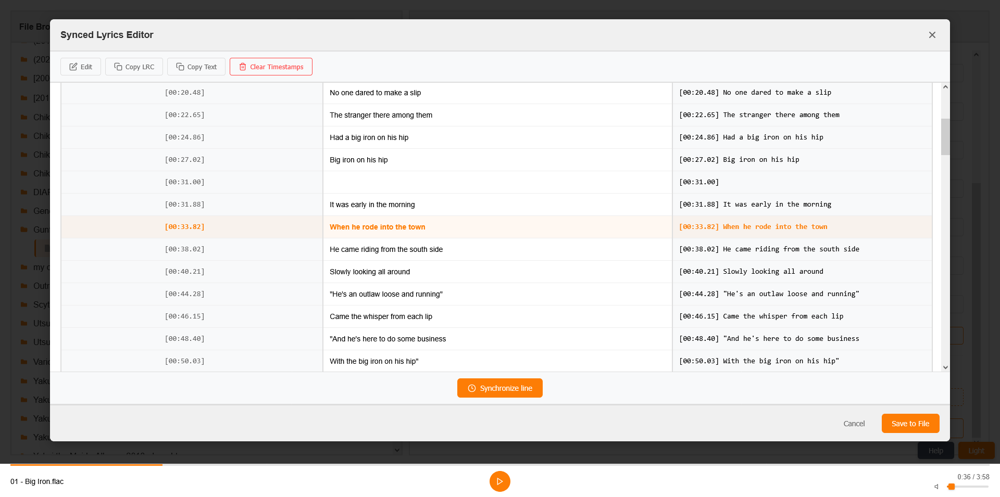
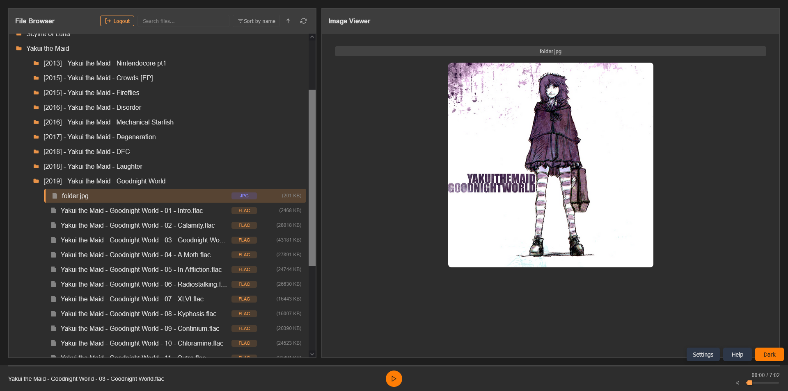
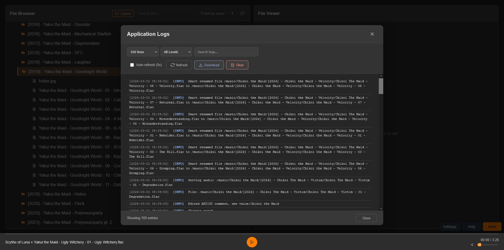
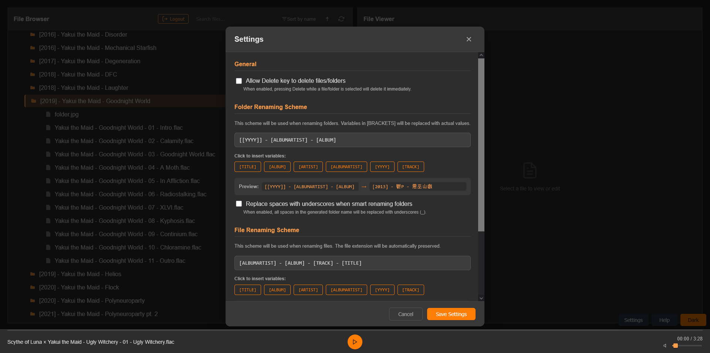
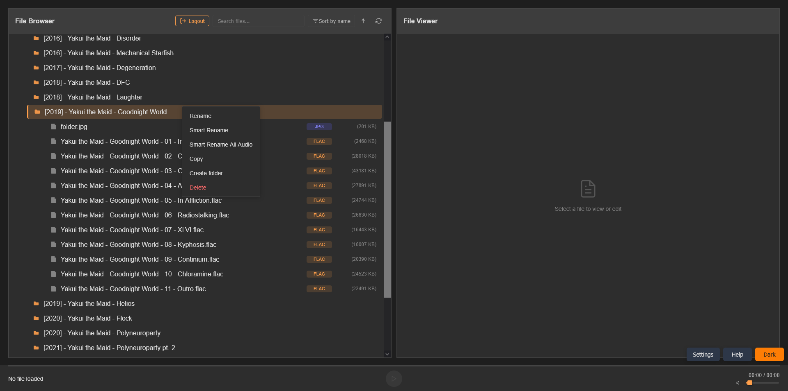

# metadata-docker

A self-hosted web application for editing audio file metadata (MP3/FLAC/OGG/Opus/M4A/WAV/AIFF) and managing audio library with a built-in audio player, synchronized lyrics editor, and file browser. Personal project that started as a way to manage Navidrome library.



App could be useful to anyone selfhosting their own music streaming service like Navidrome or anyone with a large audio library to manage.

## Features
- Easy setup with docker-compose.yml
- Metadata Editor - Edit common and custom tags for MP3, FLAC, OGG/Opus, M4A, WAV and AIFF files
- Cover Art Management - Upload, view, delete, and extract cover art
- File Management: Upload files/folders via browser or move items within the filetree, delete/rename/copy with context menu operations
- Batch Operations - Apply metadata changes to entire folders
- Include/exclude subfolders operations
- Smart Rename - Rename files/folders based on created scheme and metadata fields
- Built-in audio player
- Synced Lyrics Editor - Create and edit LRC format synchronized lyrics
- Search & Sort - Filter and sort your music library
- Image Viewer - View cover art and other images
- Authentication - Simple login protection
- Log Viewer - Monitor application logs
- Addon support - Fetch metadata from any source using addons
- Container healthcheck and non-root execution by default

## Limitations:
- History is saved with logs, but there is no way to undo changes

## Quickstart

Using docker-compose.yml:

```yaml
services:
  app:
    image: ghcr.io/jonny-ponny/metadata-docker:latest
    container_name: metadata-docker
    ports:
      - "8888:5000"                                 # Change 8888 to preferred port
    restart: unless-stopped
    environment:
      - AUTH_USERNAME=USERNAME                      # Login
      - AUTH_PASSWORD=PASSWORD                      # Plain text password
      - TOKEN_EXPIRE_HOURS=24                       # Optional
      - PUID=1000                                   # User(optional)
      - PGID=1000                                   # Group(optional)
      - TZ=UTC                                      # Timezone(optional)
    volumes:
      - ~/path/to/your/music:/music                 # Library
      - ./logs:/logs                                # Logs
      - ./addons:/app/addons                        # Addons
    # Healthcheck is inherited from the image. Uncomment to disable it.
    #healthcheck:
    #  disable: true
```
Change environment variables according to your preferences

Start the container with:

```docker compose up -d```

Or if using Compose V1:

```docker-compose up -d```

Access the web interface at http://your-server:8888 (or your configured port)

Use your auth credentials from docker-compose.yml

## Verifying the image

GHCR images are built by GitHub Actions from this repo and get a signed build-provenance attestation, so you can check an image really came from here and not from a manual push.

You need the [GitHub CLI](https://cli.github.com/):

```bash
docker login ghcr.io   # gh reads the image digest from the registry

gh attestation verify oci://ghcr.io/jonny-ponny/metadata-docker:latest \
  --repo Jonny-Ponny/metadata-docker \
  --signer-workflow Jonny-Ponny/metadata-docker/.github/workflows/container-release.yml
```

For a release tag, add `--source-ref refs/tags/v1.0.4` and use the matching image tag (`1.0.4`). On older `gh` versions, drop `--signer-workflow` and keep `--repo`.

Successful verification means the image was built by this repo's workflow. Anything else (no attestation, another workflow or repo) means it was not.

The commit is also stored on the image and shown in the app.

Tags like `latest` move with every push to `main`; digests don't. To pin the exact image you run, use its digest:

```bash
docker buildx imagetools inspect ghcr.io/jonny-ponny/metadata-docker:latest
# Digest: sha256:...
```

```yaml
image: ghcr.io/jonny-ponny/metadata-docker@sha256:...
```

This proves origin, not safety. If you don't trust the maintainer, build it yourself:

```bash
git clone https://github.com/Jonny-Ponny/metadata-docker.git
cd metadata-docker
docker build -t metadata-docker .
```

See [SECURITY.md](SECURITY.md).

## Environment Variables
Variable|Description|Default
|---|---|---|
DEBUG|Enable debug mode|False
AUTH_USERNAME|Login username|admin
AUTH_PASSWORD|Login password|admin
TOKEN_EXPIRE_HOURS|JWT token expiry|24
PUID|User ID for file permissions|1000
PGID|Group ID for file permissions|1000

Make sure user/group ID has proper file permissions. The container runs as an unprivileged user by default; set `PUID`/`PGID` to match the owner of your music folder, or set both to `0` to run as root (not recommended).

## Healthcheck

The image defines a `HEALTHCHECK` that polls the unauthenticated `/api/ping` endpoint, so `docker ps` reports the container as healthy once the app and its addon dependencies are ready.

An unhealthy status alone does not restart the container. Addons are installed before the app starts, so a slow first boot can briefly show `(unhealthy)` and then recover.

To disable it for a deployment, uncomment the `healthcheck` block in `docker-compose.yml` or add:

```yaml
services:
  app:
    healthcheck:
      disable: true
```

You can also override the image defaults (`interval`, `timeout`, `start_period`, `retries`) in the same block, for example a longer `start_period` for addons with heavy dependencies.

## Volume Mounts
Mount|Purpose
|---|---|
~/path/to/your/music:/music|Your music library
./logs:/logs|Application logs
./addons:/app/addons|Addon folder

## Addons

Addons are small Python plugins that fetch metadata from outside sources. They show up as "fetchers" in the metadata editor: pick one, search for a song or album, then apply the results to one file or a whole folder.

The app ships with no addons. You install the ones you want by dropping them into the `addons` folder, which `docker-compose.yml` mounts at `/app/addons`. Everything in that folder is scanned once at container start.

### Installing an Existing Addon

Working examples: [MusicBrainz](https://github.com/Jonny-Ponny/md-musicbrainz-addon), [VocaDB](https://github.com/Jonny-Ponny/md-vocadb-addon), [LrcLib](https://github.com/Jonny-Ponny/md-lrclib-addon) (lyrics, songs only), and [Genius](https://github.com/Jonny-Ponny/md-genius-addon).

Clone addon repo into its own subfolder inside `addons`:

```bash
mkdir -p addons
git clone https://github.com/Jonny-Ponny/md-musicbrainz-addon.git addons/musicbrainz
git clone https://github.com/Jonny-Ponny/md-lrclib-addon.git addons/lrclib
```

Then restart the container so it discovers the new files:

```bash
docker compose restart
```

The addon now appears in the metadata editor's fetcher dropdown (and in **Settings → Addons**, which also lists the methods and environment variables it supports).

#### Folder layout

A subfolder per addon is the easiest option. You can also drop a single `.py` file directly into `addons/`, with no subfolder:

```text
addons/
├── musicbrainz/                 # subfolder layout
│   ├── MusicBrainz.py
│   └── MusicBrainz_requirements.txt
├── lrclib/
│   ├── LrcLib.py
│   └── requirements.txt         # name does not matter in a subfolder
└── simple_addon.py              # flat layout
```

Only files ending in `requirements.txt` are installed, so the dependency file must be named accordingly. In a subfolder any `*requirements.txt` works (e.g. `requirements.txt` or `LrcLib_requirements.txt`). Directly in `addons/` it must end with `_requirements.txt`, e.g. `simple_addon_requirements.txt` - a plain `requirements.txt` in the flat root is ignored.

#### Environment variables

Some addons need an API key or a setting. Read the addon's README to see which variables it expects, then add them to the `environment` section of your `docker-compose.yml` and recreate the container:

```yaml
services:
  app:
    environment:
      - AUTH_USERNAME=USERNAME
      - AUTH_PASSWORD=PASSWORD
      - MD_MUSICBRAINZ_FETCH_COVER=true   # example addon setting
      - MY_API_KEY=your-key-here          # example API key
```

The names shown under **Settings → Addons** are informational - the addon decides whether a missing value is a hard error or just falls back to a default. In practice, set what the addon's README asks for.

A restart is not enough after changing `environment` values; recreate the container so Docker applies them:

```bash
docker compose up -d
```

A few things to keep in mind:

- The container installs `*requirements.txt` dependencies on every start, before the app launches. The first start after adding an addon can take a bit longer.
- Dependencies are installed inside the container, so changing an addon's requirement file requires a container restart.
- Plugins are loaded once at startup; editing a `.py` file or adding a new one has no effect until you restart.
- A broken addon is skipped with an error in the logs (`docker compose logs`). One bad addon will not stop the app.

### Writing Your Own Fetcher

An addon is a single Python file that subclasses `MetadataFetcher` from `addon_base.py`. Subclass it, set four attributes, and implement only the methods you need.

```python
# addons/my_service/MyService.py
import os
import requests
from addon_base import MetadataFetcher


class MyService(MetadataFetcher):
    name = "My Service"                 # shown in the UI
    id = "my_service"                   # unique, lowercase, no spaces
    description = "Fetches metadata from My API"
    version = "1.0.0"                   # optional, shown in Settings
    github = "https://github.com/you/md-my-service-addon"  # optional, shown as a link
    required_env_vars = ["MY_API_KEY"]  # informational only

    BASE_URL = "https://api.example.com"

    def __init__(self):
        self.api_key = os.getenv("MY_API_KEY", "")
        self.session = requests.Session()
        self.session.headers.update({"User-Agent": "metadata-docker-addon/1.0"})

    def search_songs(self, query, limit=5):
        resp = self.session.get(
            f"{self.BASE_URL}/search",
            params={"q": query, "limit": limit, "key": self.api_key},
            timeout=10,
        )
        resp.raise_for_status()
        return [
            {
                "id": str(item["id"]),          # required: passed back to fetch_song_metadata
                "title": item.get("title", ""),
                "artist": item.get("artist", ""),
                "extraInfo": item.get("duration", ""),  # optional, display-only
            }
            for item in resp.json().get("results", [])
        ]

    def fetch_song_metadata(self, song_id):
        resp = self.session.get(
            f"{self.BASE_URL}/track/{song_id}",
            params={"key": self.api_key},
            timeout=10,
        )
        resp.raise_for_status()
        data = resp.json()
        return {
            "title": data.get("title", ""),
            "artist": data.get("artist", ""),
            "album": data.get("album", ""),
            "albumArtist": data.get("album_artist", ""),
            "date": data.get("release_date", ""),
            "trackNumber": data.get("track_number", ""),
            "genre": data.get("genre", ""),
            "picture": data.get("cover_url"),   # URL or data:image/... value
        }
```

Save the file as `addons/my_service/MyService.py`, restart the container, and the fetcher is available.

#### Required attributes

| Attribute | Purpose |
|---|---|
| `name` | Display name in the frontend |
| `id` | Unique identifier. Used in API URLs and stored in the browser, so keep it stable |
| `description` | Short line shown in Settings |
| `version` | Optional version string shown in Settings |
| `github` | Optional GitHub URL shown as a clickable link in Settings. Only `github.com` links are displayed |
| `required_env_vars` | List of env var names to display in Settings. Not enforced by the app |

#### The four methods

You do not need all of them. Leave out the ones your service cannot support - the UI only shows fetchers that implement the matching search method.

| Method | Called when | Returns |
|---|---|---|
| `search_songs(query, limit)` | Song search | List of result dicts, each with an `id` |
| `fetch_song_metadata(song_id)` | A song result is selected | One metadata dict |
| `search_albums(query, limit)` | Album search | List of result dicts, each with an `id` |
| `fetch_album_metadata(album_id)` | An album result is selected | List of metadata dicts, one per track |

The `id` from a search result is passed to the matching `fetch_*` method. Search results also feed the result list in the UI, so include `title`/`artist` for songs and `album`/`artist`/`coverart` for albums where available. `coverart` is only a thumbnail for the search results; use `picture` in fetched metadata to actually embed artwork.

#### Metadata fields

Return plain key/value dictionaries using the app's field names (`title`, `artist`, `album`, `albumArtist`, `date`, `genre`, `trackNumber`, `diskNumber`, `comment`, `composer`, `publisher`, `releaseType`, `lyrics`, `unsyncedLyrics`, `picture`, ...). Unknown keys are kept and written as custom tags, so service-specific IDs (e.g. `musicbrainz_trackid`) can be returned too.

#### Extra information in the UI

Search results and fetched metadata may include an optional display-only `extraInfo` key. It is shown under the result title and above the field picker, but it is never offered as a tag or written to a file. Use it for short plain text that helps identify a result or explain where it came from, such as song duration, the source, or how metadata was aggregated. Omit the key or return an empty string when there is nothing to show.


Older addons may return `year`, `track`, or `disk`. Those are still accepted and treated as `date`, `trackNumber`, and `diskNumber`, but they are not written as literal YEAR/TRACK/DISK tags. New addons should use the current names.

#### Practical tips

- Use `os.getenv()` for API keys and settings, and give sensible defaults where possible.
- Set a `User-Agent` and a `timeout` on HTTP requests; rate-limit if the service requires it.
- Raising an exception is fine - the API returns it as an error and the UI shows the message. Returning an empty list from a search is often friendlier for "no results".
- Avoid doing network calls at import time. Keep them in `__init__` or in the methods, so a temporarily unavailable service does not break loading.
- Dependencies go in a `*requirements.txt` file next to the addon, one package per line. The container installs them on the next start.
- `addon_base` is importable because the backend runs from the directory containing it. Outside Docker, the addons folder is resolved relative to the process working directory (`backend/addons` if you run the backend from `backend/`).

For reference check working examples.


## Troubleshooting

### Permission Issues
If you encounter permission errors accessing your music files:
- Verify PUID/PGID match your host user/group (the container defaults to `1000:1000`)
- Check folder permissions: `ls -la /path/to/your/music`
- Ensure your user has read/write access

### Can't Access Web Interface
- Verify the container is running and healthy: `docker ps` (see the `STATUS` column)
- Check logs: `docker logs metadata-docker`
- Ensure selected port (default 8888) isn't blocked by firewall


## Usage Guide

### File Browser
- Click folders to expand/collapse
- Click files to load in player/view metadata
- Right-click for context menu (Rename, Smart Rename, Copy, Delete, Create folder)
- Drag & drop files/folders from your computer to upload
- Drag & drop items within the browser to move them

### Smart Rename
- Create a scheme using main metadata fields or use default
- Use Smart Rename from context menu in filebrowser to rename files/folders/all folder audio

### Metadata Editing
- Select an audio file from the browser
- Edit any field in the right panel
- Press Enter or click icons to save:
- File icon - Apply to current file only
- Folder icon (hold) - Apply to all files in folder
- Trash icon (hold) - Delete the field
- Use "Apply All Changes" to save multiple fields at once
- Toggle "Include subfolders" for recursive operations

### Cover Art
- Hover over cover art to reveal actions
- Upload - Click file icon for single file, hold folder icon for batch
- Delete - Hold trash icon to remove cover art
- Save as file - Extract cover art to cover.jpg in the same folder

### Lyrics Editor
Two types of lyrics are supported:
- Unsynced lyrics - Plain text lyrics
- Synced lyrics - LRC format with timestamps

In the synced lyrics editor:
- Click timestamp to jump to that position in the audio
- Click edit icon to modify timestamps manually
- Synchronize line button - Insert current playback time as timestamp
- Shift - Move all timestamps earlier or later by an offset in seconds
- Import .lrc - Load lyrics and timestamps from an .lrc file
- Export .lrc - Download synchronized lyrics as an .lrc file (with `[ti:]`/`[ar:]`/`[al:]` headers when known)
- Copy LRC - Copy with timestamps
- Copy Text - Copy without timestamps
- Clear Timestamps - Remove all timestamps

### Keyboard Shortcuts
Key|Action
|---|---|
`F2`|Rename selected item
`Delete`|Delete selected item
`Enter`|Apply current field changes
`Esc`|Close modals / cancel rename


## Technology

Backend: Python, Flask, Gunicorn, Mutagen

Frontend: Svelte 5

Authentication: JWT


## Acknowledgments

[mutagen](https://github.com/quodlibet/mutagen) - Audio tag extracting/writing

[Flask](https://github.com/pallets/flask) - Backend framework

[Svelte](https://github.com/sveltejs/svelte) - Frontend framework

[Gunicorn](https://github.com/benoitc/gunicorn) - WSGI server

[metadata-remote](https://github.com/wow-signal-dev/metadata-remote) - Some features were inspired by this project


## License
Copyright (c) 2026 [JonnyPonny](https://github.com/Jonny-Ponny)

This project is licensed under the **AGPLv3** - see [LICENSE](LICENSE).

It uses:
- **Flask** (BSD-3) for backend
- **Gunicorn** (MIT) for WSGI server
- **Mutagen** (GPLv2) for audio metadata
- **PyJWT** (MIT) for authentication
- **Svelte** (MIT) for the frontend

See [NOTICE](NOTICE) and [THIRD-PARTY-LICENSES](THIRD-PARTY-LICENSES) for full attribution.


## Screenshots

LRC editor:


Image file preview:


Logs:


Settings:


Context menu options:



## AI Disclaimer

This project utilized AI tools primarily for regex, frontend CSS styling and JavaScript troubleshooting. All code was manually checked and tested before finalizing.